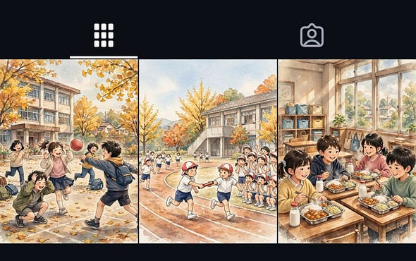
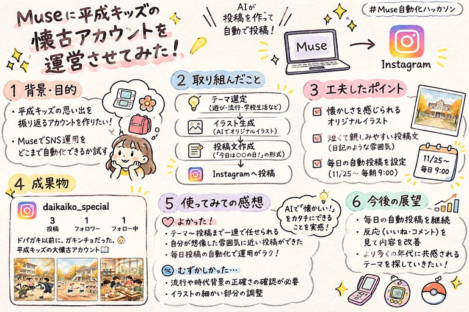

こんにちは！3年の野中です。

今回のMuse自動化ハッカソンでは、Instagramの投稿作成から公開までをMuseに任せてみました！

> 作成したもの

テーマは「平成キッズの大懐古アカウント」です。

最近、シール帳やたまごっち、ガチャガチャなど、私たちが小学生くらいの時にブームだったものが再流行しています。

そこで、2004〜2007年生まれくらいの世代(2026年現在の大学生)が、小学生の頃に夢中になっていた遊びや流行、学校での何気ない日常などを、毎日1つずつ振り返ることができるアカウントを作成しました。

自分自身、懐かしいものを見たり、小学生時代のことを友達と話したりすることが好きなので、投稿を見た人が「あったあった！」「懐かしい！」と思えるようなアカウントを目指しました。

> 今回取り組んだこと

まず、Instagramに「大懐古（@[daikaiko\_special](https://www.instagram.com/daikaiko_special?jplx=MWJ1Ymc0aTRieXltYQ%3D%3D&utm_source=qr)）」という専用アカウントを作成し、Museと連携しました。

Muse(Muse Spark 1.3)には、以下の作業をお願いしました。

* 投稿するテーマの選定
* テーマに合ったAIイラストの生成
* Instagramのキャプション作成
* Instagramへの投稿

投稿内容は、2005〜2018年頃に流行したものや遊び、学校生活の思い出などです。

また、季節感も大切にしたかったので、夏にはプールや夏休み、秋には運動会や落ち葉遊びなど、その時期に合ったテーマを選ぶように指示しました。

> 工夫したポイント

**① 懐かしさを感じられるイラスト**

投稿には、当時の小学生の生活をイメージしたAIイラストを使用しました。

既存のキャラクターや商品の画像をそのまま使用するのではなく、学校の風景や遊んでいる様子をオリジナルのイラストで表現するようにしました。

また、アカウント全体に統一感が出るよう、温かみのあるイラストの雰囲気を意識しました。

**② 懐かしい気持ちになる投稿文**

投稿文は長い説明ではなく、「今日は〇〇の日！」というタイトルに、あの頃の記憶が蘇るような小学生ならではの口調を意識した文章を添える形式にしました。

単に昔の出来事を紹介するのではなく、当時の小学生の目線で書くことで、より懐かしさを感じられるように工夫しました。

> 成果物

Museを使って、Instagramに3件の投稿を公開することができました！

実際に投稿された画像は、どれも温かみのあるイラストで、アカウント全体にも統一感が生まれました。

**Instagramアカウント**

<https://www.instagram.com/daikaiko_special?hvrq=MWJ1Ymc0aTRieXltYQ%3D%3D&utm_source=qr>

**成果物①**

<https://medium.com/media/f6b9e7dc529362f7ac290742c25b4623/href>

**成果物②**

<https://medium.com/media/616038e3c2238848d2fe66546f7c4b5e/href>

**成果物③**

<https://medium.com/media/08d6d0fc7c0ac2912d0a53f7aa0b17e3/href>
> 振り返り

今回Museを使ってみて、テーマを考えるところから画像生成、文章作成、Instagramへの投稿まで、一連の作業をしっかり任せることができました。

修正をお願いしたり、要望を増やしたりしても、特に拒否することなく指示通りに動いてくれました！

今後は毎日の投稿を継続し、どんなテーマが選ばれるのか、どこまで安定して運用できるのかを確認していきたいです！

> グラレコ

ChatGPT-6

---

[Museに平成キッズの懐古アカウントを運営させてみた！👶🏻‪‪🎒](https://medium.com/furuhashilab/muse%E3%81%AB%E5%B9%B3%E6%88%90%E3%82%AD%E3%83%83%E3%82%BA%E3%81%AE%E6%87%90%E5%8F%A4%E3%82%A2%E3%82%AB%E3%82%A6%E3%83%B3%E3%83%88%E3%82%92%E9%81%8B%E5%96%B6%E3%81%95%E3%81%9B%E3%81%A6%E3%81%BF%E3%81%9F-8c42edf1aa63) was originally published in [Furuhashi(mapconcierge)Lab.](https://medium.com/furuhashilab) on Medium, where people are continuing the conversation by highlighting and responding to this story.
