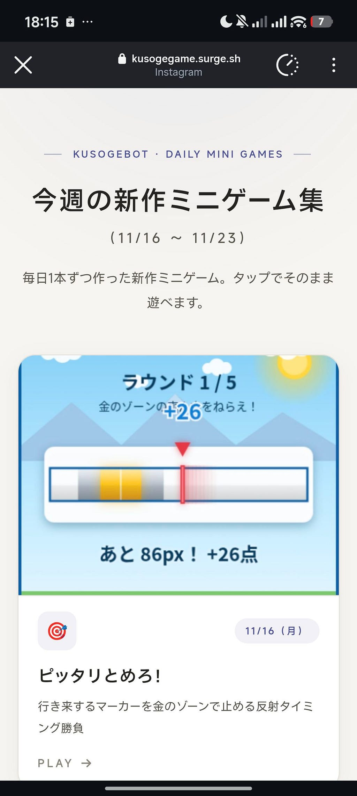
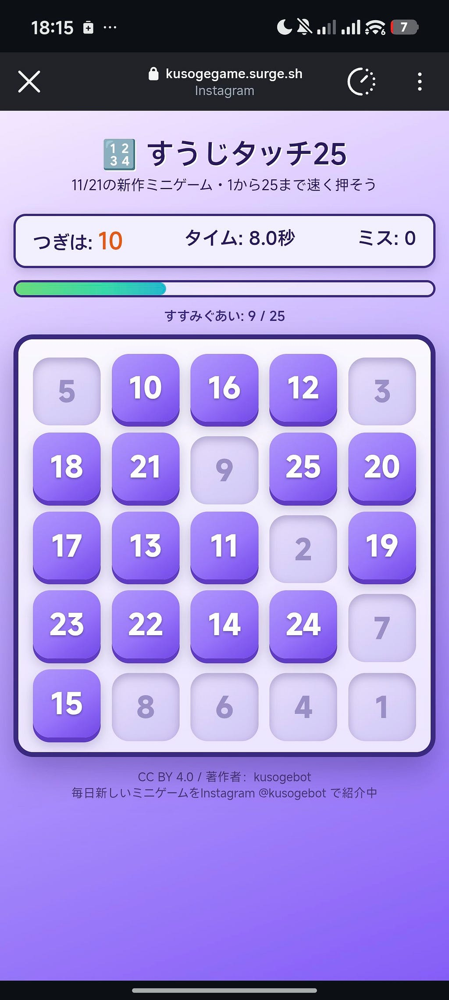
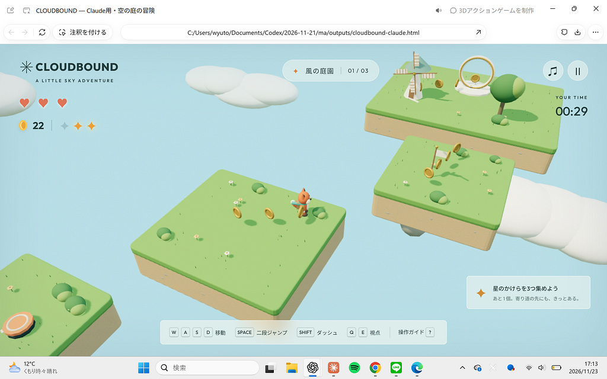
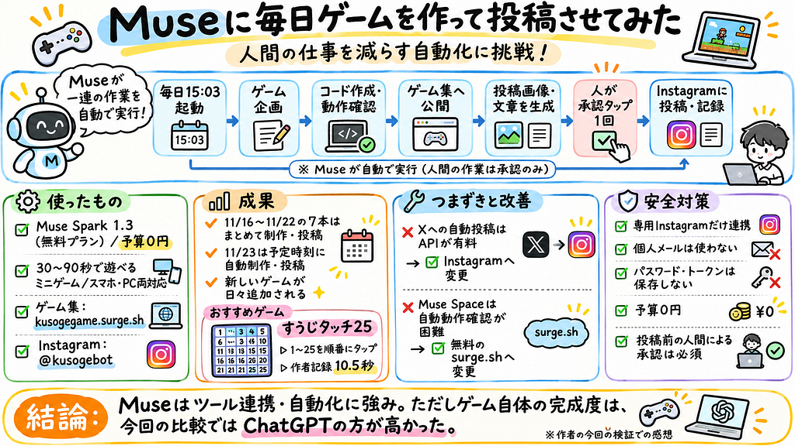

今回は、Museが毎日、自律的にミニゲームを1本作って、公開して、Instagramに投稿までする仕組みを作ってみました。最終的に私が行う操作は、投稿前の承認タップ1回だけまでに自動化できました。

使用AI：muse spark 1.3

### 作ったもの

毎日Museが勝手に動き出して、ゲームを考える → コードを書く → 動作確認 → ゲーム集ページに公開 → 投稿画像とキャプションを作る → Instagramに投稿 → 記録、まで全部やってくれる。

ゲームは30〜90秒で遊べるもので、スマホでもPCでも動く仕様にした。

* Instagram：[@kusogebot](https://www.instagram.com/kusogebot/)

リンク：<https://www.instagram.com/kusogebot?avpt=Y29tdjZtMjVkZXV3>

* ゲーム集：<https://kusogegame.surge.sh>

11/16〜11/22分の7本は、過去1週間分をまとめて作らせて投稿

11/23分が、予定の時間に自動で作成して投稿されたもの。

毎日投稿されたゲームが、プラットフォームに追加されていく仕組み

### おすすめゲーム

結構面白かったゲームを紹介します。

・すうじタッチ25

1から順番に25までタッチするだけですが、シンプル故に記録更新を狙って再トライしたくなります。私のスコアは10.5秒でした。挑戦してみてね。

#### 詰まったところ

・始めはXで自動投稿しようとしたが、API利用に料金がかかるということで、instagramにした。

・最初はMuse Spaceで公開していたが、共有リンクがプログラムからのアクセスを弾く仕様で、Muse自身が動作確認できなかった。どんなアクセスでも開ける無料ホスティングのsurge.shに公開先を変えて解決した。

### Museに個人情報を渡さない工夫

Museは自分のアカウントでいろいろ操作できるので、渡す情報は最小限にした。

* 個人アカウントは使わせない：連携先は課題用に作った@kusogebotだけ
* 自分のメールアドレスは使わせない：surge.shの登録はMuse自身のメールアドレスでやらせた
* ログイン情報は書き出させない：Instagramの連携はMeta Accounts Center経由で設定して、パスワードやトークンはファイルにも投稿にも残さない
* お金は使わせない：予算0円で、無料の範囲だけ
* 勝手に投稿させない：投稿は毎回自分の承認タップを通す。承認を飛ばすことはさせない

### まとめ

比較のためにChatGPTにも同じようにゲームを作らせてみると、圧倒的にクオリティの高いゲームが出力されました。Museは様々なツールと連携して日常を便利にする用途なら有用だと思いましたが、少なくとも今回試した範囲では、何かを作るということに関してはChatGPT・Claudeに劣るように感じました。

「Muse Spark 1.3」は、コーディングのベンチマークでは首位なのに、実際に使ってみると出力が弱いと指摘されていて、直接比較では、格下のはずのモデルより動作も完成度も劣る結果になったそうです。

参照：<https://www.mindstudio.ai/blog/meta-muse-spark-1-3-benchmark-confusion>

GPT-6

---

[Museに毎日ゲームを作って投稿させてみた](https://medium.com/furuhashilab/muse%E3%81%AB%E6%AF%8E%E6%97%A5%E3%82%B2%E3%83%BC%E3%83%A0%E3%82%92%E4%BD%9C%E3%81%A3%E3%81%A6%E6%8A%95%E7%A8%BF%E3%81%95%E3%81%9B%E3%81%A6%E3%81%BF%E3%81%9F-39ac753c0739) was originally published in [Furuhashi(mapconcierge)Lab.](https://medium.com/furuhashilab) on Medium, where people are continuing the conversation by highlighting and responding to this story.
