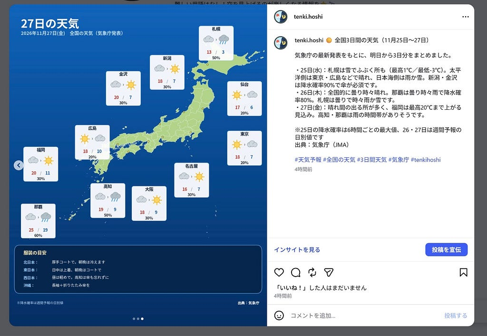
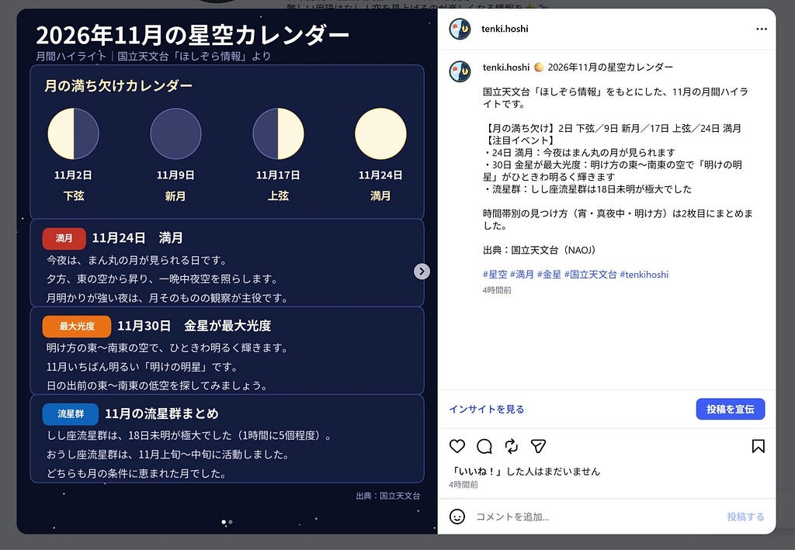
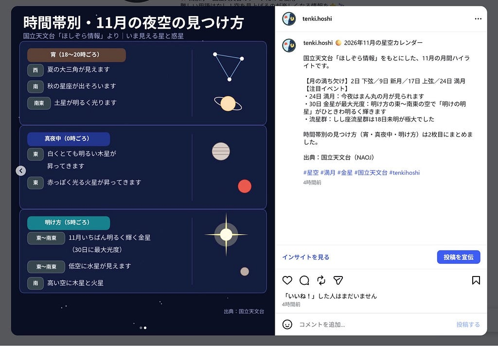
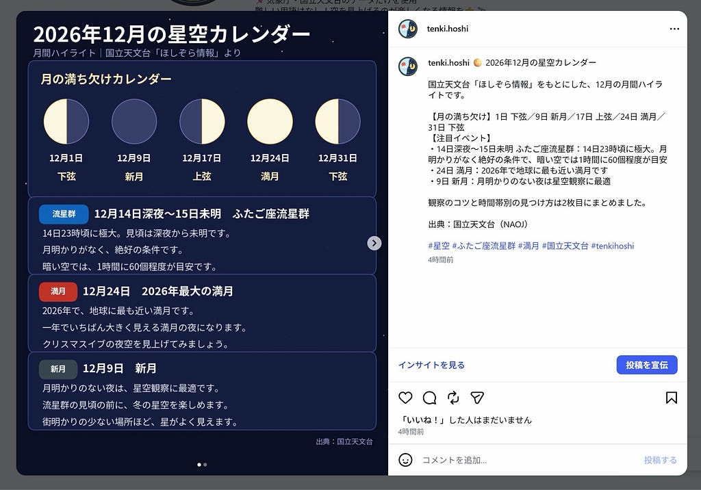
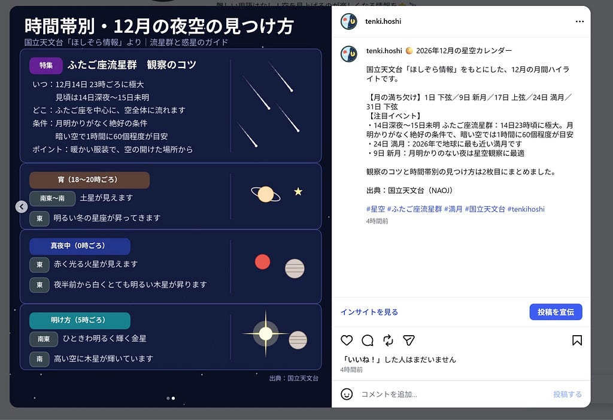
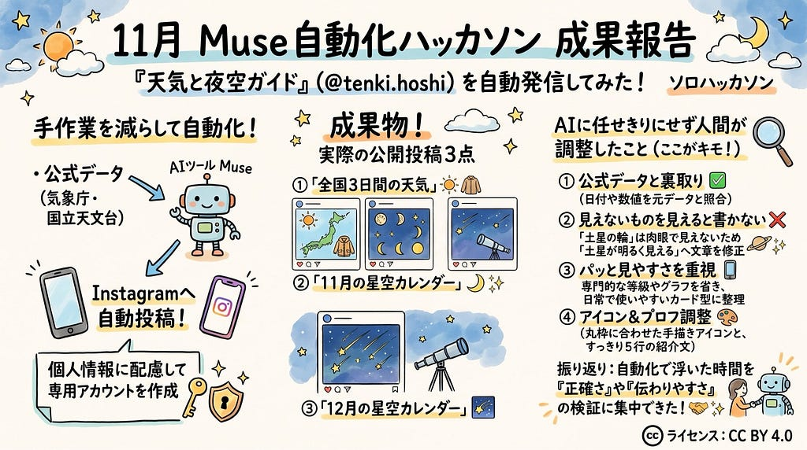

## るMuseを使って「天気と夜空ガイド」を発信してみた

こんにちは、4年の安生です。

> **はじめに**

今回、Muse 自動化ソロハッカソンとして、全国の主要都市の天気と月ごとの夜空の楽しみ方を届けるInstagramアカウント「天気と夜空ガイド（[@tenki.hoshi](https://www.instagram.com/tenki.hoshi/)）」を立ち上げました。

天気や星空の情報を毎回ゼロから調べて画像を作り、文章を整えて投稿する作業は人間の負担が大きくなりがちです。そこで今回は、Museを用いて情報収集から画像生成・キャプション作成・SNS公開までの流れを自動化し、人間側の作業負荷をどこまで減らせるかに挑戦しました。

あわせて、設定時に個人情報が漏れないよう、個人アカウントとは完全に分離した専用アカウント（[@tenki.hoshi](https://www.instagram.com/tenki.hoshi/)）を用意して運用しています。

> **作成した成果物**

> 信頼性と権利面を考慮して、天気は**気象庁（JMA）**、星空は**国立天文台（NAOJ）「ほしぞら情報」**の公式データのみを使用し、以下の3本を公開しました。

**1.全国3日間の天気（2026年11月25日〜27日）**

主要都市の天気・気温・降水確率と、地域ごとの服装の目安を3枚組でまとめた投稿です。

<https://medium.com/media/310d7dd628a3151422abeb13d903fd41/href>

**2.2026年11月の星空カレンダー**

月の満ち欠けや満月・金星の最大光度に加え、時間帯別（宵・真夜中・明け方）に見える星と惑星をまとめた投稿です **。**

<https://medium.com/media/2fd287d5fa89c9715728f34af2522a89/href>

**3.2026年12月の星空カレンダー**

12月の月の満ち欠け、ふたご座流星群の観察のコツ、2026年最大の満月、時間帯別の夜空の見つけ方をまとめた投稿です。

<https://medium.com/media/b5975212b8c7a719bf950cdce64f4ee7/href>
> **人間側で確認・調整した点**

Museを使うことで、データ取得から画像・キャプション生成、投稿作業までにかかる手間を大幅に削減できました。一方で、自動生成したものをそのまま出すのではなく、「人間は最終チェックと方向性の調整に集中する」形で、以下の3点を重点的に見直しました。

① 公式データをもとに、日付や数値を人の目で裏取りした

信頼性を保つため、天気は気象庁、星空は国立天文台の公式情報だけを使うルールにしました。そのうえで、生成された3日間の天気の対象日や各地の気温・降水確率、月の満ち欠け・天文イベントの日付にズレがないか、公式ページと突き合わせて確認しています。

②「見えないものを見える」と書かないように修正した

星空ガイドの初期案では、宵の空の説明に「輪のある土星」という表現が入っていました。しかし、土星本体は肉眼でも明るい星のように見えますが、「輪」までは望遠鏡がないと見えません。誤解を招かないよう、イラストは土星とひと目でわかるアイコンのままにしつつ、文章は「土星が明るく光ります」「土星が見えます」へと修正しました。あわせて国立天文台の星図や惑星の出没時刻も確認し、時間帯と方角に矛盾がないか裏取りしています。

③ スマホでパッとわかるように、項目と表現を絞った

天気や星空の情報は、データをそのまま並べると情報量が多くなりすぎて見づらくなってしまいます。そこで、見る人が本当に知りたい項目だけに絞り込み、表現もかみ砕いて整理しました。

具体的には、星の明るさを示す「等級」などの専門的な表記は省き、天気も「天気・気温・降水確率・服装の目安」といった日常で使いやすい情報に絞っています。デザインも、天気は日本地図ベース、星空はイラスト付きで整理し、スマホ画面でひと目で内容が入ってくる見やすさを優先しました。

> **振り返り**

今回の取り組みを振り返ると、初期案では「等級」「月齢」といった細かい数値まで盛り込まれてしまい、情報量が多く見づらくなっていました。AIは多くの情報を網羅しようと詰め込む傾向があるため、スマートフォンで見る人に向けて「何を載せないか」を見極める引き算の判断は、人間側が担う必要があると感じました。

制作から投稿までのルーティン作業をMuseに任せて浮いた時間を、こうした情報の取捨選択や、公式データとの照合、初見の人が誤解しない表現かどうかの検証に充てることができ、AIと人間の役割分担の大切さを改めて実感しています。

> ライセンス

本記事および本ハッカソンで作成したオリジナル投稿コンテンツは、CC BY 4.0（クリエイティブ・コモンズ 表示 4.0 国際）のもとで公開します。

※投稿内で使用している気象・天文データの権利は、出典元である気象庁および国立天文台に帰属します。

**グラレコ**

Gemini

---

[Museを使って「天気と夜空ガイド」を発信してみた](https://medium.com/furuhashilab/muse%E3%82%92%E4%BD%BF%E3%81%A3%E3%81%A6-%E5%A4%A9%E6%B0%97%E3%81%A8%E5%A4%9C%E7%A9%BA%E3%82%AC%E3%82%A4%E3%83%89-%E3%82%92%E7%99%BA%E4%BF%A1%E3%81%97%E3%81%A6%E3%81%BF%E3%81%9F-0ce8cfd87c59) was originally published in [Furuhashi(mapconcierge)Lab.](https://medium.com/furuhashilab) on Medium, where people are continuing the conversation by highlighting and responding to this story.
