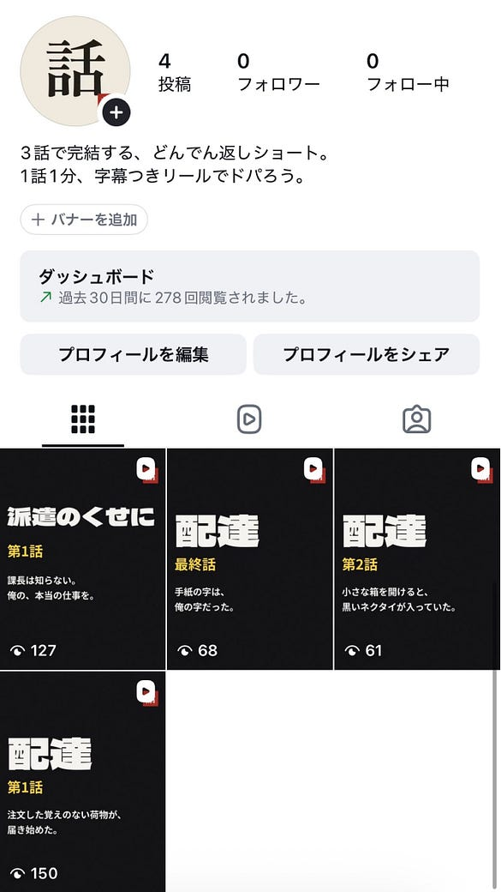

### SNSでよく見かけるAIショート動画をMuseに作らせてインスタに自動投稿するところまで任せてみた

コンニチハあらしょうです。22日にENgaWAのショッキングピンクの車に乗っているお兄さんにお誘いいただき、初めて社会人サッカーに参加しました。脳は高校の頃の動きをイメージしてるけど、身体が全く動かなくて死ぬかと思いました。

今回は、[Muse自動化ハッカソン](https://github.com/furuhashilab/README/issues/42#issuecomment-6937176219)ということでコンテンツ作成から投稿までMuseを使って試してみました。個人的にはかなりワクワクするハッカソンで、あらしょうプレゼンツ2026年度ベストハッカソンにノミネートされそうだなと思います。

[アカウント](https://www.instagram.com/1minshort_bymese/)  
私は、TikTokなどでよく見る、「めっちゃAIじゃん！きもちわる！でもなんか2倍速にして見ちゃう！ドパ！」というドラマショートを、台本作成から動画生成・投稿までMuseにお任せしてみました。  
1日1本、3話完結の台本で、1本当たり1分の構成にしました。早送り前提ならもう少し長くしてみてもいいなと今この記事を書きながら思っています。

すごくアバウトで適当な指示でも70％ぐらいの出来で、「主人公の顔が変わっちゃってるよ！誰このおじさん！」みたいな指摘をすると、その後の第2話以降では改善されて同じような問題は起きなくなりました。  
気になる点としては、クレジット消費で、やはり動画生成は重いタスクだなと実感しています。

実はこのショートアカウントの前に、ネットミームの解説と元ネタを教えてくれる、スーパードパガキの荒川にとっては最高のアカウントをやってみたのですが、主に著作権の問題が面倒で断念しています。  
「ミームは自分で発掘するからドパれるしなあ」とも思ったので、今回のショートアカウントに切り替えました。

#### まとめ

完全に自己満足なテーマで進めてみましたが、Museの動画生成スキルや性格を知ることができて良かったなと思います。  
やっぱり収益化やバズを狙いたいので、今後も試行錯誤しながらしばらくはMuseに労働してもらうつもりです。

---

[SNSでよく見かけるAIショート動画をMeseに作らせてインスタに自動投稿するところまで任せてみた](https://medium.com/furuhashilab/sns%E3%81%A7%E3%82%88%E3%81%8F%E8%A6%8B%E3%81%8B%E3%81%91%E3%82%8Bai%E3%82%B7%E3%83%A7%E3%83%BC%E3%83%88%E5%8B%95%E7%94%BB%E3%82%92mese%E3%81%AB%E4%BD%9C%E3%82%89%E3%81%9B%E3%81%A6%E3%82%A4%E3%83%B3%E3%82%B9%E3%82%BF%E3%81%AB%E8%87%AA%E5%8B%95%E6%8A%95%E7%A8%BF%E3%81%99%E3%82%8B%E3%81%A8%E3%81%93%E3%82%8D%E3%81%BE%E3%81%A7%E4%BB%BB%E3%81%9B%E3%81%A6%E3%81%BF%E3%81%9F-0c4f82f9cf70) was originally published in [Furuhashi(mapconcierge)Lab.](https://medium.com/furuhashilab) on Medium, where people are continuing the conversation by highlighting and responding to this story.
