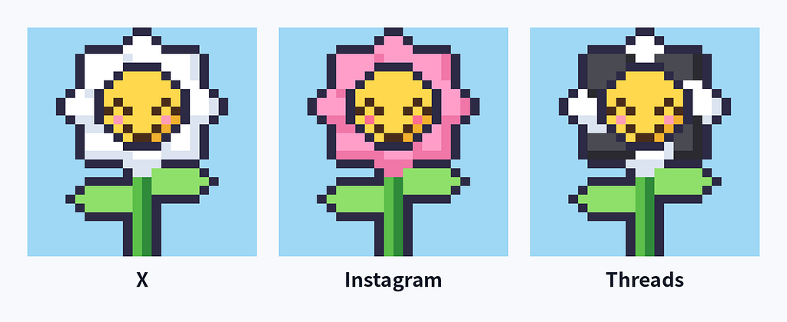
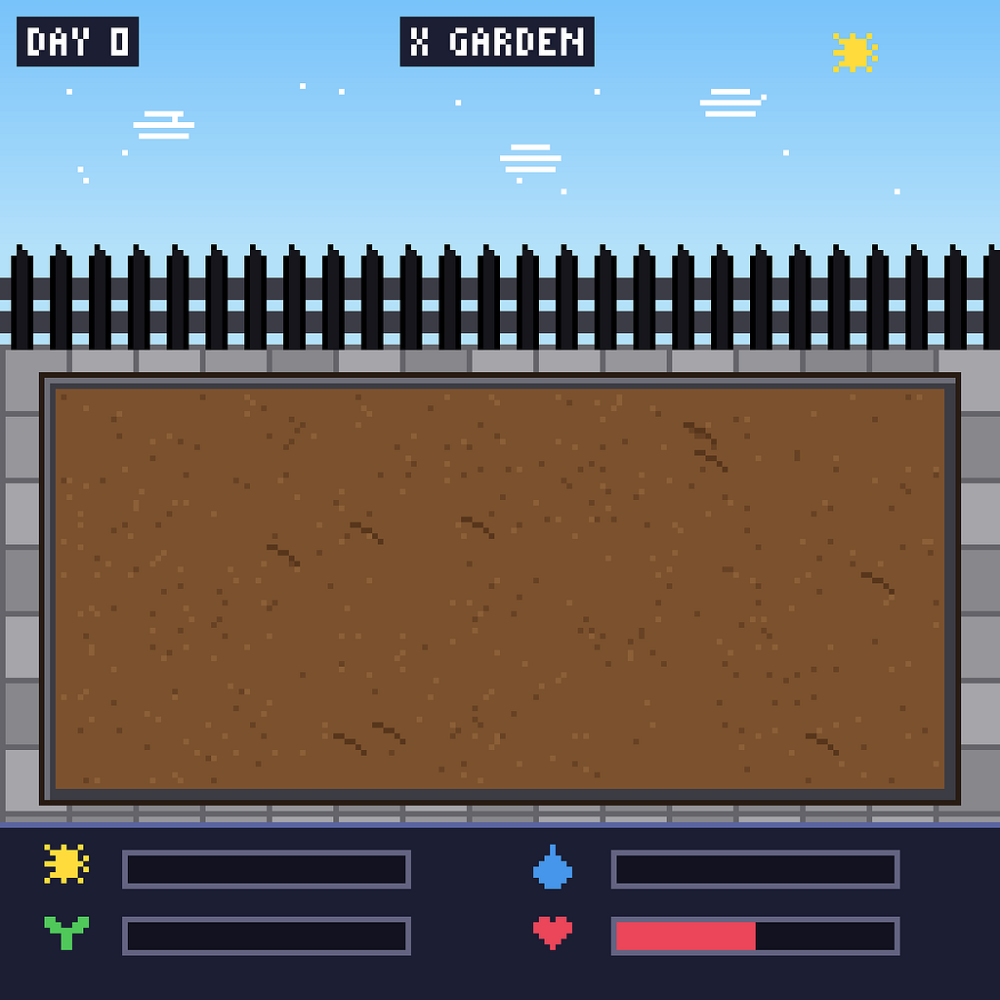
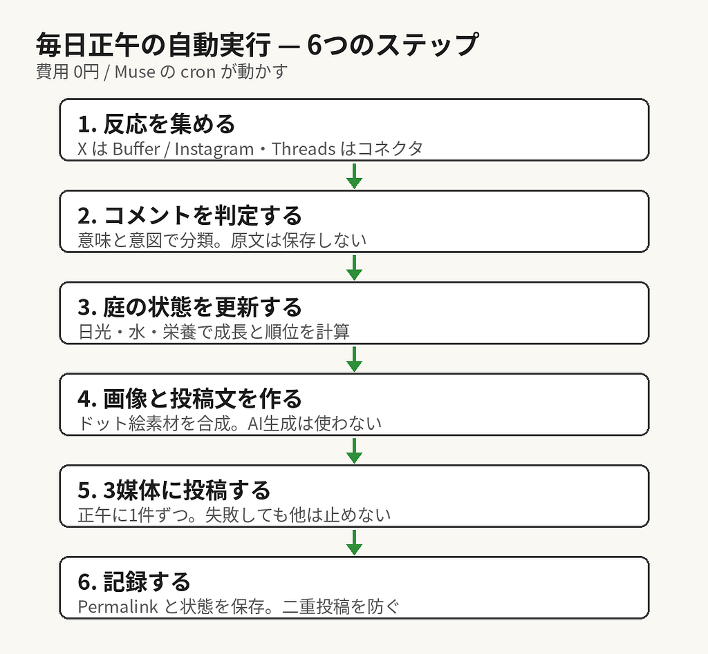
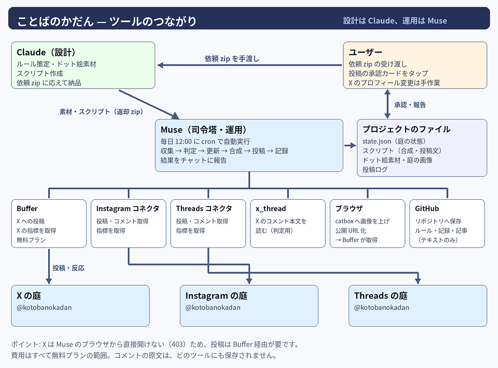
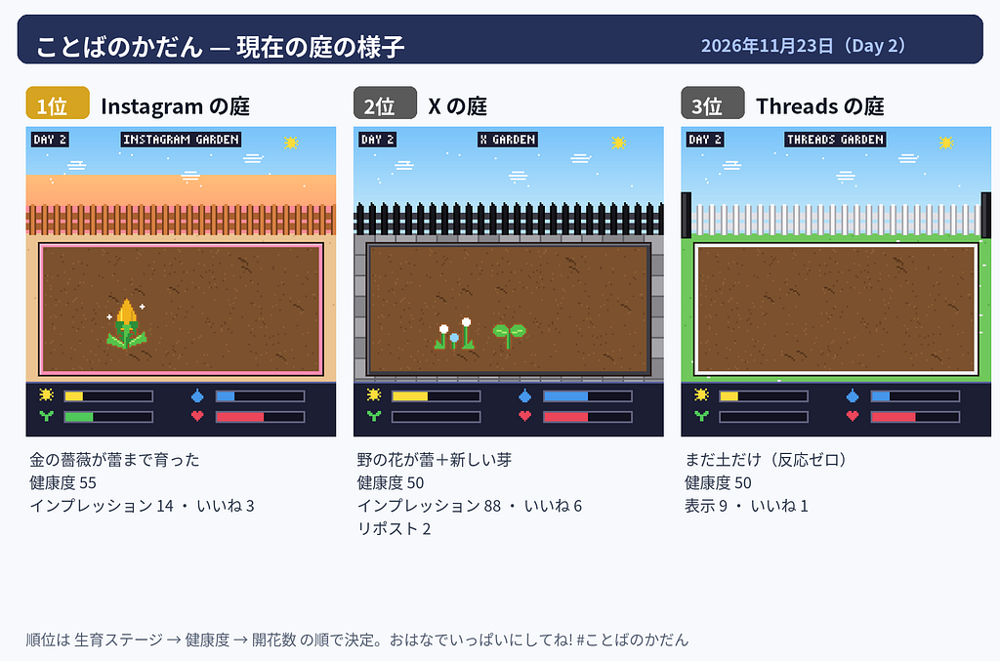
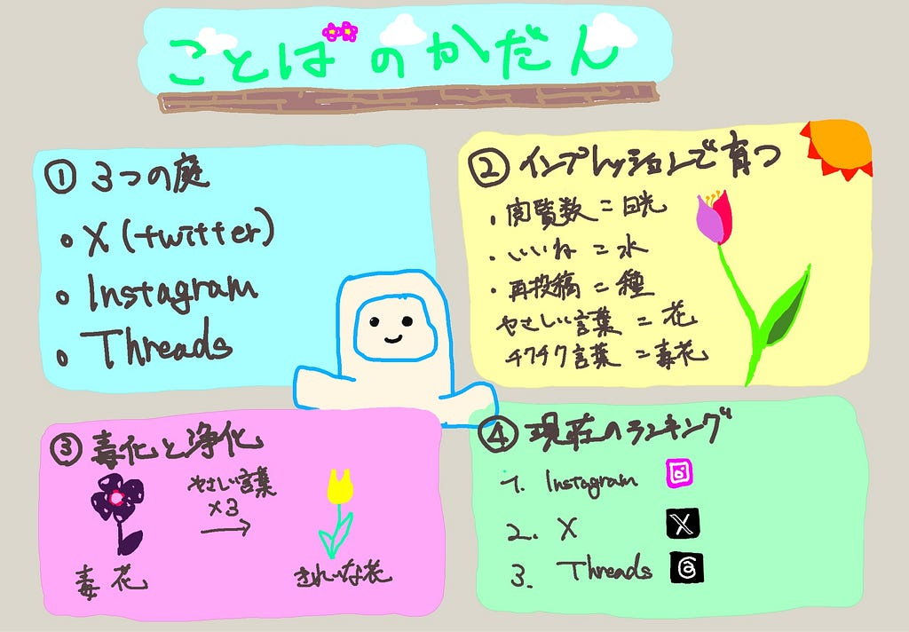

こんにちは！本吉です。  
今回はインターネットを浄化するような作品を作ってみました。  
その名も「ことばのかだん」です。

土だけの庭を、X・Instagram・Threadsに1つずつ作りました。

インプレッションや返信に応じて花壇に花が育ちます。

*- Xの庭：@kotobanokadan (*[*https://x.com/kotobanokadan*](https://x.com/kotobanokadan)*)*

*- Instagramの庭：@kotobanokadan (*[*https://www.instagram.com/kotobanokadan*](https://www.instagram.com/kotobanokadan)*)*

*- Threadsの庭：@kotobanokadan (*[*https://www.threads.com/@kotobanokadan*](https://www.threads.com/@kotobanokadan)*)*

それぞれの媒体のアイコン。かわいいでしょう。

Day 0・Xの庭

### ことばのかだん — 概要、なにができるか

「ことばのかだん」は、SNSごとに架空の庭を1つ作り、その媒体の住人の反応だけで育てる連載です。反応を庭の環境に置き換えています。

* 反応：庭への効果
* インプレッション：日光。その日に進められる成長の上限を決める
* いいね：水。花の基礎的な成長に必要
* ふわふわしたコメント：栄養。花の種類を決め、芽を1つ植える
* リポスト／シェア：種。野の花の芽を1つ植える
* 保存／ブックマーク：肥料。その日の水の効果を1.5倍にする（取得できる媒体のみ）
* 新規フォロワー：植えられる場所が増える（初期3か所、上限14か所）
* チクチクしたコメント：毒花が芽吹き、庭の健康度が下がる

花は「芽 → 茎 → 蕾 → 開花」の順に育ちます。いいね（水）だけでは開花せず、ふわふわした言葉（栄養）が1件以上必要です。逆に日光だけでも育ちません。

コメントの内容によって、咲く花の種類が変わります。   
【ふわふわ言葉】

* 応援・励まし → ひまわり
* 感謝 → さくら草
* 面白い・笑い → チューリップ
* 褒め・すごい → 金の薔薇（レア）
* 絵文字のみ・短い好意・「見てますよ」といった存在の肯定 → 野の花

【チクチク言葉】からは毒花が育ちます。

* 悪口:ラフレシア
* 嫌味:ハエトリソウ
* - 断定的なダメ出し:サボテン
* 煽り:チリペッパー花
* 強い悪意:ラックホール花  
  **ただし毒花は終わりではありません。**ふわふわした言葉が3件届くと、毒花1輪が普通の花に変わる「**浄化**」が起きます。たとえばラフレシアは、浄化されると巨大な金の薔薇になります。

### 構成 — AIとサービスがどうつながっているか

毎日の流れは、次の6ステップです。Museのcronが正午に動かし、費用は0円です。

毎日正午の自動実行の流れ

1. 反応を集める — XはBufferの無料プラン、InstagramとThreadsは公式コネクタ経由で、前日の投稿への反応を集めます。取得できない指標は「取得不可」として記録し、推測で埋めません。

2. コメントを判定する — コメントを、言葉の字面ではなく意味と意図で分類します。コメントの原文は投稿にも記録にも載せず、投稿者を名指しすることもありません。

3. 庭の状態を更新する — 日光・水・栄養から成長と順位を計算し、1つの状態ファイルに保存します。

4. 画像と投稿文を作る — 事前に用意したドット絵素材をプログラムで合成し、その日の庭の画像と投稿文を作ります。毎日の画像生成にAI生成は使いません。

5. 3媒体に投稿する — 正午に1件ずつ投稿します。1つの媒体で失敗しても、他の媒体は止めずに独立して処理します。

6. 記録する — Permalinkと状態を保存し、二重投稿を防ぎます。

**判定の対象は庭・花・画像・順位に向けられた言葉だけに限ります**。他の人への発言や無関係な話題は対象外です。差別、脅迫、特定の個人への攻撃、自傷を促す言葉は、庭には一切反映しない「集計外」として扱い、件数だけを記録します。悪口ダメゼッタイ。

判定のイメージが伝わるよう、テストで使った架空の例文を紹介します。

#### 言葉の例：判定：庭への効果

「毎日応援してます！がんばれ〜」：ふわふわ（応援）：栄養になり、花の芽が植わる

「ドット絵のクオリティ高すぎ」：ふわふわ（褒め）：栄養になり、花の芽が植わる

「明日も見に来ようかな」：ふわふわ（遠回しな好意）：栄養になり、花の芽が植わる

「センスない庭」：チクチク（悪口）：ラフレシアが芽吹き、健康度が下がる

「そのお花、咲いているうちはきれいだね」：チクチク（嫌味）：ハエトリソウが芽吹き、健康度が下がる

「どうせすぐ飽きるでしょ、賭ける？」：チクチク（煽り）：チリペッパー花が芽吹き、健康度が下がる

「絵は好きだけど更新頻度が鬱陶しい」：中立（好意と批判が混ざっている）：変化なし

「色の使い方、もう少し彩度を上げたらどうでしょう」：中立（敬意のある改善提案）：変化なし

### 面白さ

この企画の面白さは、**ポジティブな言葉にもネガティブな言葉にも反応すること!**

やさしい言葉をかければきれいな花が育ちますが、チクチクした言葉をかければ毒花が育ちます。だから、同じルールでも、**媒体ごとに庭の色が変わります。**

もし誰かがネガティブな言葉をいっぱいかけたら、その庭は毒々しい色の花壇になります。紫の毒花が並び、空まで暗い紫に変わる。それはそれで面白いと思っています。毒花だらけの庭と、花でいっぱいの庭が並ぶところまで見てみたいです。

### 作ってみて

面白い仕組みができたと思っています。反応を庭の環境に置き換えるルールは、作っていて手応えがありました。

ただ、この企画は**インプレッションや反応があることが前提です**。つまり、アカウントを作りたてのうちは花壇が当然インプレッションが少ないため、 花壇が全然育ちません。Day 0の反応は、Xでインプレッション18、Instagramで8、Threadsで表示5。3つの庭を合わせても、最初の1日は30件ほどの表示しかありませんでした。

事実、**Threadsのかだんは何も起こっていません**。さみしいです。Day 2まで反応がゼロで、まだ更地のままです。

### 現在のはたけの様子

### 展望

目標は、フォロワーを増やして、庭を育てることがお金になる仕組みを作ることです。Xから報酬が払われるようになるか、アフィリエイトができるようになるか。まずは庭を育てて、見に来てくれる人を増やすところからです。

庭はまだ蕾の段階です。おはなでいっぱいになるかどうかは、これから届く言葉次第です。

**おはなでいっぱいにしてね!**

**muse招待コード**

V49CR7

[Muse - Your Personal AI Agent](https://muse.ai/join)

#### 使用AIモデル

* Muse Spark 1.3
* Claude code Opus 5.5

### グラレコ

---

[現代版花咲か爺さん。SNSに花畑を作ってみよう](https://medium.com/furuhashilab/%E7%8F%BE%E4%BB%A3%E7%89%88%E8%8A%B1%E5%92%B2%E3%81%8B%E7%88%BA%E3%81%95%E3%82%93-sns%E3%81%AB%E8%8A%B1%E7%95%91%E3%82%92%E4%BD%9C%E3%81%A3%E3%81%A6%E3%81%BF%E3%82%88%E3%81%86-13d0bbf5de22) was originally published in [Furuhashi(mapconcierge)Lab.](https://medium.com/furuhashilab) on Medium, where people are continuing the conversation by highlighting and responding to this story.
