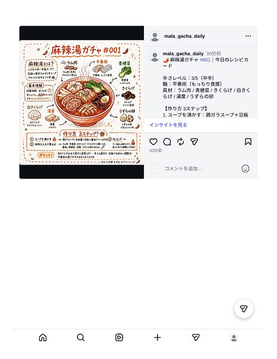
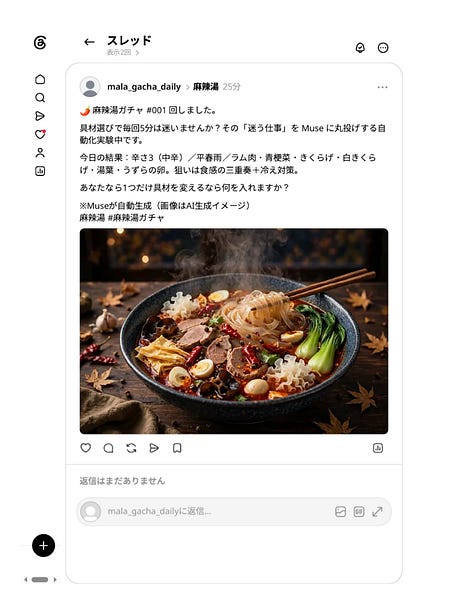
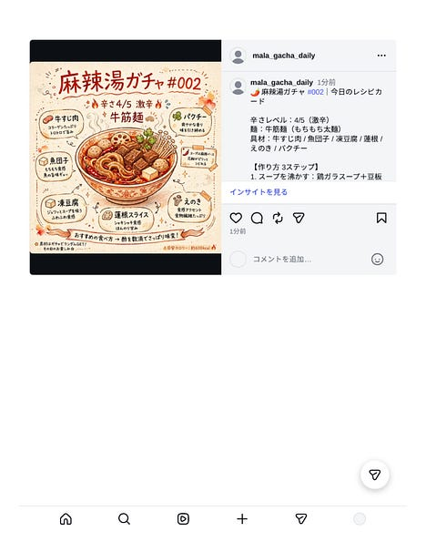
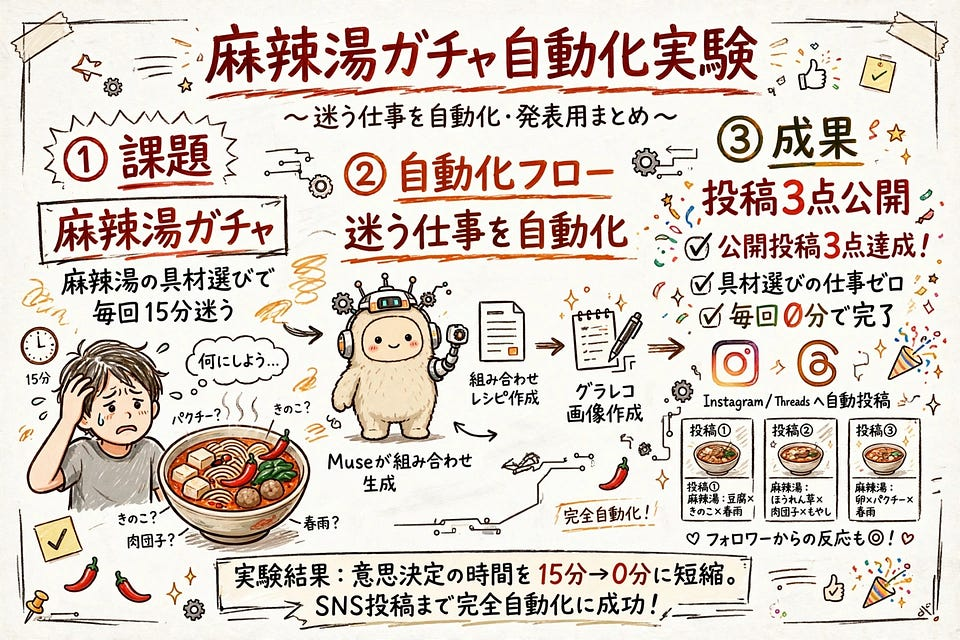

こんにちは、3年の米久保です。

今回のハッカソンは、比較的自分の好きなことを使いやすい内容だったので、大好きな麻辣湯を題材にやってみました。（麻辣湯を食べながら思いつきました）

今回はSNS（Instagramと、そのアカウントに連携させたThreads）に自動で投稿させることを目的として作ってみました。

課題：麻辣湯は「選ぶ仕事」が多すぎる

麻辣湯（マーラータン）の楽しさは自由な具材選び。でも裏を返すと、毎回こんな仕事が発生します。

- 具材30種以上から5〜7種を選ぶ（組み合わせは約59万通り）  
- 辛さレベルと麺を決める  
- 「今日はどんな気分なのか？」と自分に聞く

1回あたり約10分の「迷う仕事」。これを Muse（AIエージェント）に丸投げしたらどうなるか、というのが今回の自動化ハッカソンのテーマです。

やったこと：Muse が「決める→描く→投稿する」まで担当

自動化の流れはシンプルです。

1. 決める：Muse が曜日・季節感からテーマを決め、スープの辛さ（0〜5）／麺／具材5〜7種の組み合わせを生成  
2. 描く：完成イメージと、グラレコ風レシピカード（作り方3ステップ付き）を AI 生成  
3. 投稿する：専用アカウント「麻辣湯ガチャ研究所」（[@mala\_gacha\_daily](http://twitter.com/mala_gacha_daily)）へ、Instagram／Threads に自動投稿

人間がやるのは「投稿されたレシピを見て作る」だけ。具材選びの仕事はゼロになりました。

成果物（公開投稿3点）

### 1. Instagram #001 ― 辛さ3／平春雨

辛さ3（中辛）、麺は平春雨、具材はラム肉・青梗菜・きくらげ・白きくらげ・湯葉・うずらの卵。「食感の三重奏＋冷え対策」がテーマです。

Permalink: <https://www.instagram.com/p/DgF2QFJDu54/>

### 2. Threads #001 ― 「1つだけ変えるなら何を入れる？」

同じ #001 の組み合わせを、問いかけ形式で Threads にも投稿しました。

Permalink: <https://www.threads.com/@mala_gacha_daily/post/DgF2wnIDrk8>

### 3. Instagram #002 ― 辛さ4／牛筋麺

辛さ4（激辛）、麺は牛筋麺、具材は牛すじ肉・魚団子・凍豆腐・蓮根・えのき・パクチー。「スタミナ回復＋根菜のシャキシャキ感」がテーマです。

Permalink: <https://www.instagram.com/p/DgF3AOYjsWw/>

効果：1回10分の「迷い」がゼロに

- 従来：具材選び＋辛さ・麺決めで約10分  
- 自動化後：0分（投稿されたレシピを見るだけ）  
- しかも自分では選ばない組み合わせ（例：白きくらげ、凍豆腐）が来るので、発見もある

プライバシー配慮（Muse の設定で気をつけたこと）

- 投稿用に専用アカウントを新規作成し、個人アカウントと分離  
- 電話番号・連絡先同期・位置情報は登録しない  
- 自宅周辺の店舗名や実在店舗のメニューとは断定せず、「再現レシピ／AI生成イメージ」と明記  
- 投稿には「Museが自動生成」と明記し、透明性を確保

つまずきメモ

- ブラウザ経由の画像アップロードが動かず、Meta アカウント連携経由の自動投稿に切り替えた  
- アカウント追加時のログイン承認フローでは、本人の操作かどうかを時刻・デバイスで照合してから承認した（セキュリティ確認を自動化の都合で飛ばさない）

まとめ

「選ぶのが楽しい」はずの麻辣湯で、いちばん悩む「選ぶ仕事」だけを AI に渡す実験でした。結果毎回の麻辣湯作りの参考になるなと思いました。

アカウント作成をやらせるのに少し時間はかかりましたが、投稿の内容などは上手くいき、アレンジ方法やちゃんと健康的に野菜なども取り入れてるのが好印象でした。

自分にも有益な情報だったのでこのアカウントに時々投稿してみようと思います。

グラレコ

---

[麻辣湯の具材選びをAIに丸投げした結果「麻辣湯ガチャ」自動化実験🌶❤️](https://medium.com/furuhashilab/%E9%BA%BB%E8%BE%A3%E6%B9%AF%E3%81%AE%E5%85%B7%E6%9D%90%E9%81%B8%E3%81%B3%E3%82%92ai%E3%81%AB%E4%B8%B8%E6%8A%95%E3%81%92%E3%81%97%E3%81%9F%E7%B5%90%E6%9E%9C-%E9%BA%BB%E8%BE%A3%E6%B9%AF%E3%82%AC%E3%83%81%E3%83%A3-%E8%87%AA%E5%8B%95%E5%8C%96%E5%AE%9F%E9%A8%93-%EF%B8%8F-66336a6fe15f) was originally published in [Furuhashi(mapconcierge)Lab.](https://medium.com/furuhashilab) on Medium, where people are continuing the conversation by highlighting and responding to this story.
