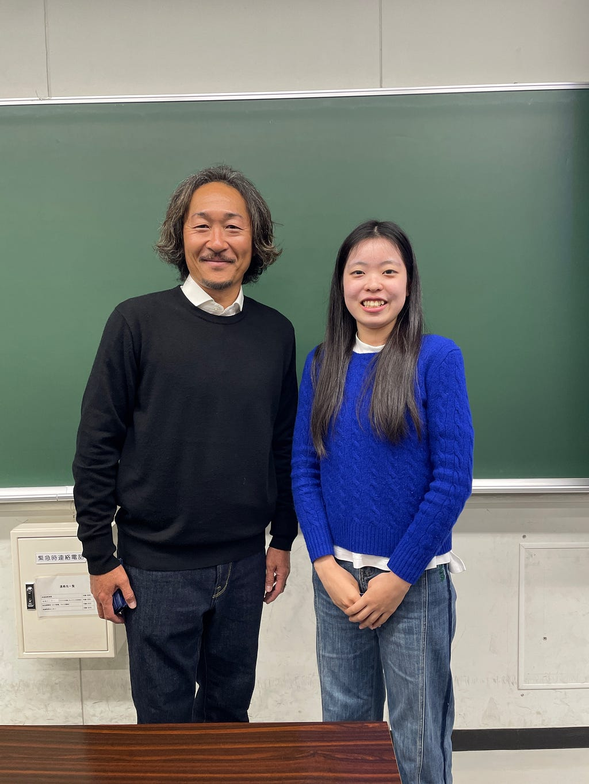
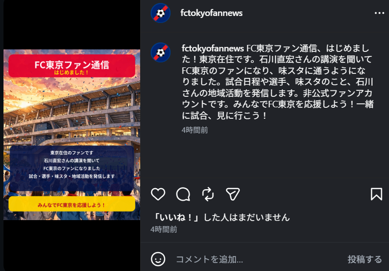
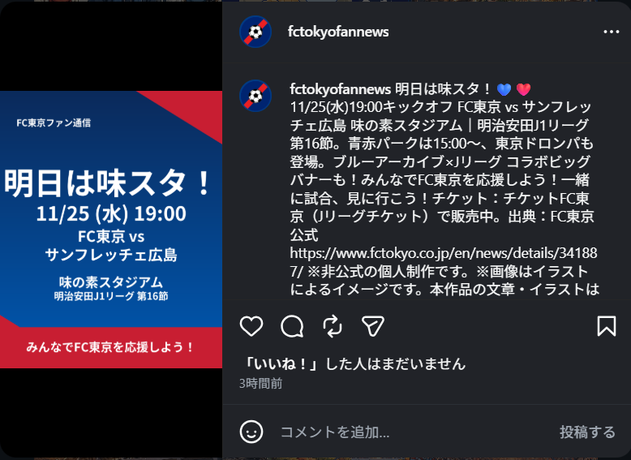
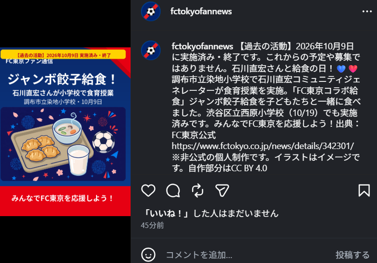
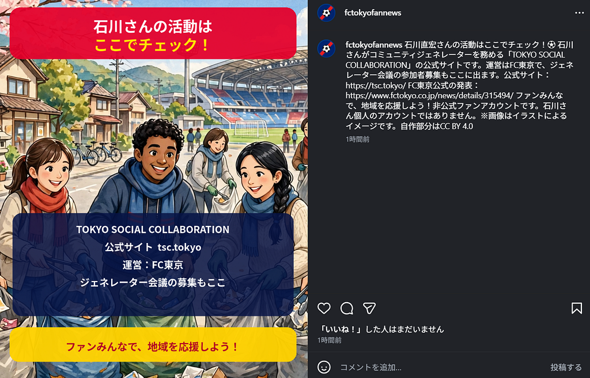
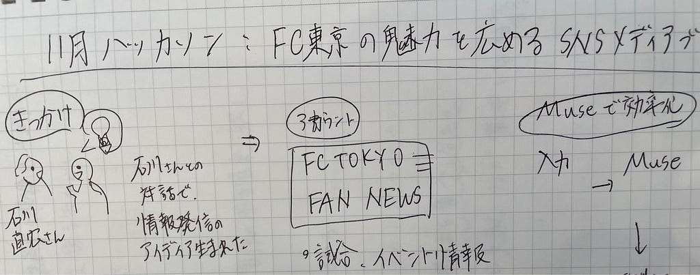

### 11月ハッカソン／古橋研究室

こんにちは、佐藤愛妃です

先日、FC東京の石川直宏さんのお話を聞く機会がありました。

2026/11/17

そこで、私自身も何かFC東京の活動に関われないかと考え、動画やSNSを活用した情報発信について提案しました。

今回は、そのとき考えていたことを少しずつ実践するため、11月のハッカソンを機に、FC東京のファン向けInstagramアカウントを立ち上げました！

試合の動画を使うと権利関係で問題起きそうだったので、石川さんに相談しています。今回はすべてCCBY4.0で統一しています

**FC TOKYO FAN NEWS**

<https://www.instagram.com/fctokyofannews/>

### 01｜ファン自身が魅力を発信する

サッカークラブの魅力は、試合結果や選手の活躍だけではありません。

スタジアム周辺のまちの雰囲気や、試合観戦までの道のり、選手やクラブが取り組む地域活動など、さまざまな魅力があると思います。

しかし、こうした情報は、普段からクラブの情報を追っている人でなければ、なかなか知る機会がありません。

そこで、ファン自身が情報を発信し、SNSを通じて拡散することで、これまでFC東京に関心がなかった人にも魅力を届けられないかと考えました。

### 02｜今回のハッカソン

今回のテーマは、Museを活用して人間の仕事を減らすことです。

SNSで継続的に情報を発信する場合、情報収集、投稿内容の企画、画像や動画の制作、文章の作成など、意外と多くの作業が発生します。

個人でアカウントを運営する場合、これらの作業を毎回手動で行うことは、継続するうえで大きな負担になります。

そこで今回は、Museを活用し、SNS投稿コンテンツの制作作業を効率化することに挑戦しました。

### 03｜発信するコンテンツ

今回のアカウントでは、以下のようなコンテンツを企画しました。

* FC東京の試合日程やイベント情報
* 味の素スタジアムの紹介
* 飛田給駅からスタジアムまでの道のり
* 石川直宏さんやFC東京の地域活動・社会貢献活動の紹介

特に、古橋研究室で扱っている地理空間情報技術を生かし、実際の街並みやスタジアムへの道のりを3D都市モデルなどで表現するコンテンツにも、今後挑戦したいと考えています。

初めて観戦する人にとっても、スタジアムまでの道のりそのものが楽しみになるような動画を作ってみたいです。

### 04｜Museを活用した制作フロー

従来は、人間が情報を集め、投稿の構成を考え、画像や動画を制作し、投稿文を作成する必要がありました。

今回目指したのは、こうした一連の制作作業をMuseによって効率化することです。

**従来**

情報収集 → 企画 → コンテンツ制作 → 投稿文作成 → 内容確認 → SNS投稿

**今回目指した仕組み**

発信テーマ・情報源の指定 → Museによるコンテンツ制作支援 → 人間による事実確認 → SNS投稿

単にAIで画像や動画を生成するだけではなく、継続的な情報発信に必要な人間の作業をどこまで減らせるのか、という点を重視しました。

一方で、試合日程やイベント情報の正確性、素材の著作権などについては、人間による確認が必要です。

### 05｜制作したコンテンツ

### 投稿①

【投稿のスクリーンショット】

Permalink：<https://www.instagram.com/p/DgGWf42joE9/?utm_source=ig_web_copy_link&dmpr=MzRlODBiNWFlZA==&avpt=MzRlODBiNWFlZA==>

### 投稿②

【投稿のスクリーンショット】

Permalink：<https://www.instagram.com/p/DgGfe_qjl7R/?utm_source=ig_web_copy_link&fqnt=MzRlODBiNWFlZA==&avpt=MzRlODBiNWFlZA==>

### 投稿③

【投稿のスクリーンショット】

Permalink：<https://www.instagram.com/p/DgGyXNsE0KP/?utm_source=ig_web_copy_link&jplx=MzRlODBiNWFlZA==&avpt=MzRlODBiNWFlZA==>

### 06｜今後の改善点・展望

#### ハイパーリンク貼れない...汗

2024/11/24

今回のハッカソンでは、以前から考えていた企画を、実際にSNSアカウントとして立ち上げることができました。

今後は、投稿への反応や再生数などを確認しながら、どのようなコンテンツがFC東京の魅力を伝えるうえで効果的なのかを検証していきたいと思います。

また、地図や3D都市モデル、ドローン映像など、研究室で扱っている技術とスポーツの情報発信を組み合わせることにも挑戦したいです。

まだ始めたばかりですが、石川さんのお話をきっかけに考えた企画を、少しずつ形にしていければと思います。

**FC TOKYO FAN NEWS**

<https://www.instagram.com/fctokyofannews/>

※本アカウントは個人が運営する非公式ファンアカウントです。

使用ツール：Muse

制作：2026年11月

License：CC BY 4.0（筆者が権利を有する文章・制作物に限ります。）

#### グラレコ

---

[FC東京の魅力をもっと広めたい！Museを活用したファンニュースの情報発信に挑戦](https://medium.com/furuhashilab/fc%E6%9D%B1%E4%BA%AC%E3%81%AE%E9%AD%85%E5%8A%9B%E3%82%92%E3%82%82%E3%81%A3%E3%81%A8%E5%BA%83%E3%82%81%E3%81%9F%E3%81%84-muse%E3%82%92%E6%B4%BB%E7%94%A8%E3%81%97%E3%81%9F%E3%83%95%E3%82%A1%E3%83%B3%E3%83%8B%E3%83%A5%E3%83%BC%E3%82%B9%E3%81%AE%E6%83%85%E5%A0%B1%E7%99%BA%E4%BF%A1%E3%81%AB%E6%8C%91%E6%88%A6-bd12e167b8b7) was originally published in [Furuhashi(mapconcierge)Lab.](https://medium.com/furuhashilab) on Medium, where people are continuing the conversation by highlighting and responding to this story.
