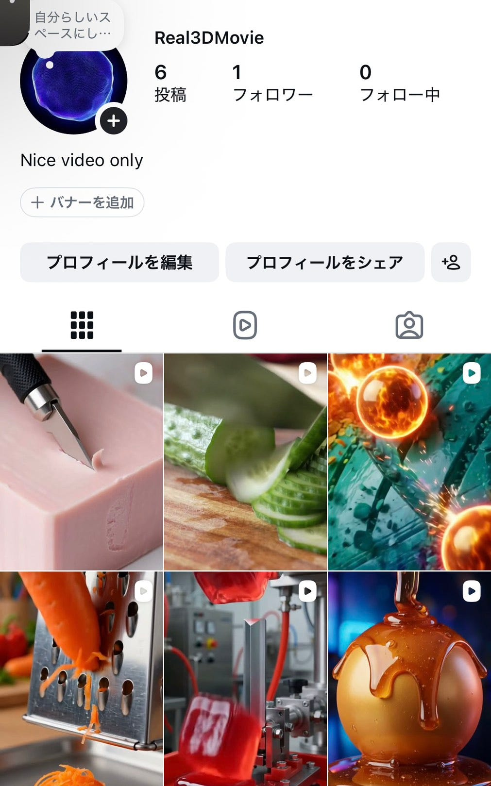
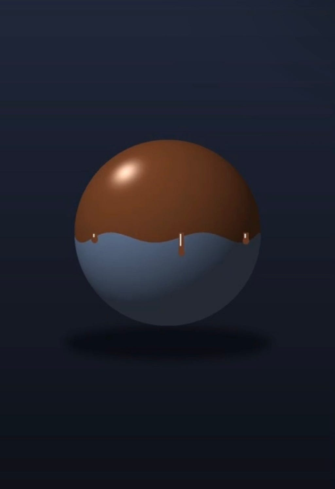
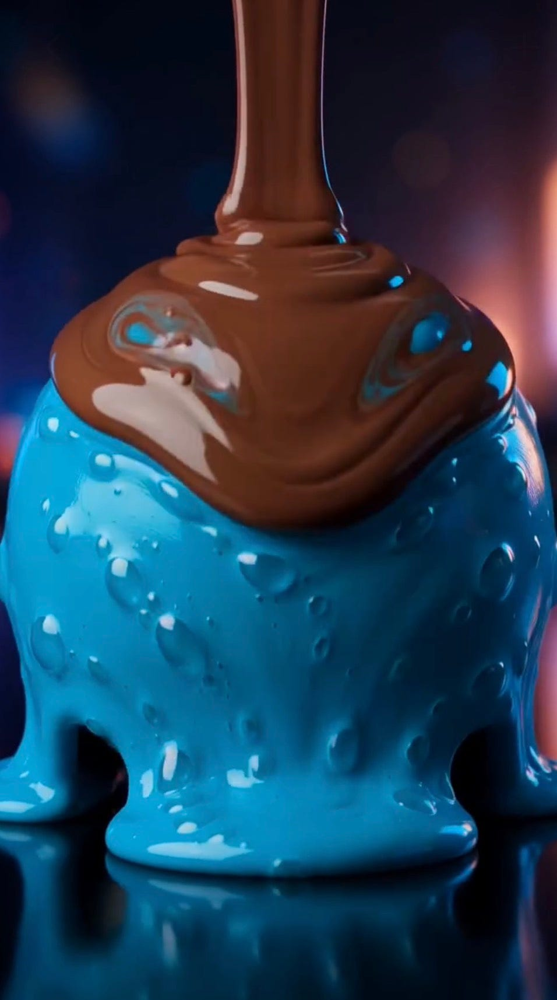
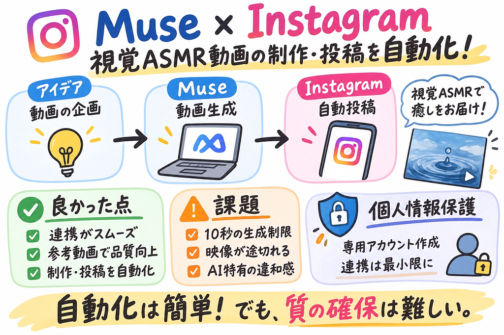

こんにちは！古橋研究室3年の中川です。

今回は、11月のMuse自動化ハッカソンに取り組みました。

今回のお題は「Museのみを用いて、人間側の仕事を減らす自動化を実装する」というものです。

私は、Instagramのリール動画でよく見かける視覚ASMR（Visual ASMR）に着目し、動画の作成からInstagramへの投稿までを自動化する仕組みを作りました。

使用したAI：Muse Spark 1.3

### 1. 作ったもの

視覚ASMRとは、規則的な動きや物体の変化、心地よい音などを通して、視覚的・聴覚的な快感を得られるコンテンツです。

Instagramのリール動画を見ていると、ついつい最後まで見てしまうような動画が多く存在します。こうした動画は、複雑なストーリーを必要としないため、AIによる継続的なコンテンツ制作と相性がよいのではないかと考えました。

今回は、以下の一連の作業をMuseに任せる仕組みを構築しました。

* 動画の内容を考える
* 視覚ASMR動画を生成する
* Instagramへの投稿を行う

【Instagramアカウントのスクリーンショット】

Instagram：<https://www.instagram.com/goodfeelinglaboratory/>

### 2. 実際に使ってみて

アカウントの作成やInstagramとの連携は、想像していたよりもスムーズに進み、比較的短時間で動画の制作に移ることができました。

最初は文章によるプロンプトのみで動画を生成しましたが、動きや演出の完成度が低く、思い描いていたものとは異なる動画が生成されました。

そこで、実際にInstagramで流れてきたリール動画を画面録画し、参考資料としてMuseに読み込ませてみました。

その結果、文章だけで指示する場合と比べて、よりリアルでイメージに近い映像を生成できるようになりました。

### 3. 苦労した点・課題

### 動画の生成時間に制限がある

今回の環境では、一度に生成できる動画の長さが10秒まででした。

そのため、30秒程度のリール動画を作成するには、複数の動画をつなぎ合わせる必要があります。しかし、映像の連続性を保つことが難しく、途切れ途切れの動画になってしまいました。

特に視覚ASMRでは、動きの連続性やリズム感が重要であるため、この制限は大きな課題だと感じました。

### AI特有の違和感

映像の質感自体はリアルであり、普段ChatGPTやClaudeなどのAIツールを利用する中で感じる生成コンテンツのリアルさに通じるものがありました。

一方で、物体の動きや映像の変化には不自然な部分があり、一目でAIによって生成された動画だと分かってしまうような違和感も残りました。

ただリアルな映像を生成するだけでなく、人間が見て心地よいと感じる動きやリズムを再現することの難しさを実感しました。

### 4. Museに個人情報を渡さないための工夫

今回、Museを使用するにあたり、普段利用している個人アカウントとは切り離して運用することにしました。

* ハッカソン専用のGoogleアカウントを作成
* 投稿専用のInstagramアカウントを作成
* 普段使用しているSNSとの連携を避ける
* アカウントやサービスとの連携を必要最小限にする

自動化によって利便性が向上する一方で、AIにどこまで情報や操作権限を与えるのかについても、十分に考える必要があると感じました。

### 5. まとめ

今回のハッカソンを通して、Museを利用することで、SNSコンテンツの制作から投稿までを自動化できることが分かりました。

自動化すること自体は比較的容易でしたが、人間が見たいと思える質の高いコンテンツを継続的に作り出すことには、難しさがあると感じました。

今後、動画生成の精度や連続性が向上すれば、SNSアカウントの運用にかかる人間の負担を大幅に削減できるのではないかと思います。これから動画内容を改善し、万バズ目指します！！

### グラレコ

**GPT-6.2**

---

[Museに視覚ASMR動画を作成・自動投稿させてみた！](https://medium.com/furuhashilab/muse%E3%81%AB%E8%A6%96%E8%A6%9Aasmr%E5%8B%95%E7%94%BB%E3%82%92%E4%BD%9C%E6%88%90-%E8%87%AA%E5%8B%95%E6%8A%95%E7%A8%BF%E3%81%95%E3%81%9B%E3%81%A6%E3%81%BF%E3%81%9F-547136ac899e) was originally published in [Furuhashi(mapconcierge)Lab.](https://medium.com/furuhashilab) on Medium, where people are continuing the conversation by highlighting and responding to this story.
