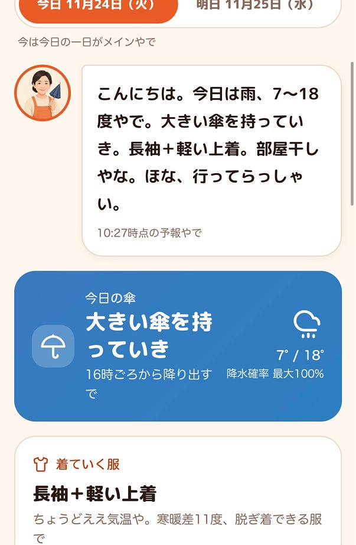
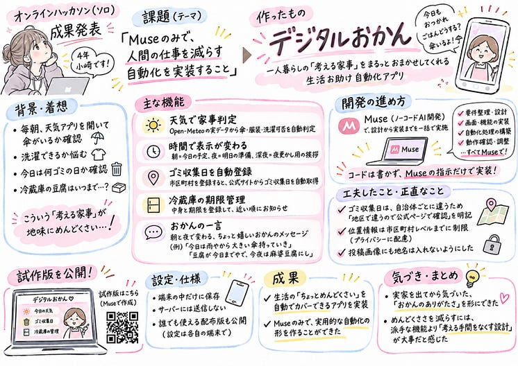

こんにちは 4年の小崎です。

今回のオンラインハッカソン（ソロ）の課題は、「Museのみで、人間の仕事を減らす自動化を実装すること」。

私は自他ともに認める、めっちゃめんどくさがり屋です。毎朝、天気アプリを開いて、傘がいるか、洗濯できるか、今日は何ゴミの日か、冷蔵庫の豆腐はいつまでか。考えるのが面倒なのではなく、考える回数そのものが面倒でした。

だったら、実家のお母さんみたいに全部先回りして教えてくれる存在を作ればいい。そうして生まれたのが、一人暮らしアプリ「デジタルおかん」です。なお、開発はすべてMuse（私の相棒「ごま」）への指示だけで行い、私はコードを1行も書いていません。

デジタルおかんとは

朝開くだけで、その日の全部が決まります。

・天気（Open-Meteoの実データ）から、傘・服装・洗濯を判定

・開いた時間で表示が変わる（朝は今日、夜は明日の準備、深夜は夜更かし仕様の挨拶）

・市区町村を登録すると、自治体公式サイトからゴミ収集日を自動調査して登録

・冷蔵庫の中身と期限を覚えて、近い順に声をかける

・朝と夜で変わる「おかんの一言」

試作版に加えて、誰でも使える配布版も公開しました。設定は各自の端末の中だけに保存され、サーバーには送られません。

配布版：

[Dezitaruokan Pei Bu Ban 2](https://muse.ai/s/dezitaruokan-pei-bu-ban-2-wxl7dxm38xa714/o7z_9I9-nNFsU9XmA_Yb-R7SZ_MPHRiBwjglgY6HOGE)

使用画面のスクショ

投稿1｜デジタルおかんと過ごす今日1日

<https://medium.com/media/437eb1b49cab519ae45a57cf9ea5b760/href>

投稿2｜明日のおかんは家事も見てる（ゴミ出し・冷蔵庫編）

<https://medium.com/media/38fa13e9baaa66b9aa4ab42a27237333/href>

投稿3｜配布版ができたで（使い方編）

<https://medium.com/media/600b5b586460d2e35457800cc861cdf2/href>

工夫したこと

・ゴミ収集日は、町名や地区ごとに違う自治体では推測で入れない。「地区で違うので公式ページで確認して」と正直に表示し、出典リンクを出す仕様にしました。

・個人情報への配慮として、位置情報は市区町村レベルまで。配布版の設定は端末内保存のみで、外部に送信しません。

・投稿画像にも地名は入れていません。

#### 配布版でつまずいたこと

配布版は当初、ブラウザから天気API（Open-Meteo）に直接取りに行く設計でした。ところが実機で開くと天気も地名検索も全滅。Safariで開き直しても同じでした。

そこで作り替えて、天気の取得先を3段構え（Open-Meteo → wttr.in → ノルウェー気象局）にし、それでも通信が通らない場合に備えて主要都市の実予報をページ内に内蔵、市区町村検索も主要都市の内蔵リストで選べるようにしました。「動くはず」と「実際に動く」は違う、というのを実機確認の大切さごと学んだのが一番の収穫かもしれません。

おわりに

「今日は雨やから大きい傘持っていき」「豆腐が今日までやで、今夜は麻婆豆腐にし」

実家を出てから聞かなくなった声が、少しだけ戻ってきた気がします。めんどくさがり屋の面倒くささは、自動化の立派な設計仕様でした。

本記事および成果物は CC BY 4.0 で公開します。

---

[めんどくさがり屋が、Museだけで実家のお母さんを実装した話](https://medium.com/furuhashilab/%E3%82%81%E3%82%93%E3%81%A9%E3%81%8F%E3%81%95%E3%81%8C%E3%82%8A%E5%B1%8B%E3%81%8C-muse%E3%81%A0%E3%81%91%E3%81%A7%E5%AE%9F%E5%AE%B6%E3%81%AE%E3%81%8A%E6%AF%8D%E3%81%95%E3%82%93%E3%82%92%E5%AE%9F%E8%A3%85%E3%81%97%E3%81%9F%E8%A9%B1-5f8d2c1c8650) was originally published in [Furuhashi(mapconcierge)Lab.](https://medium.com/furuhashilab) on Medium, where people are continuing the conversation by highlighting and responding to this story.
