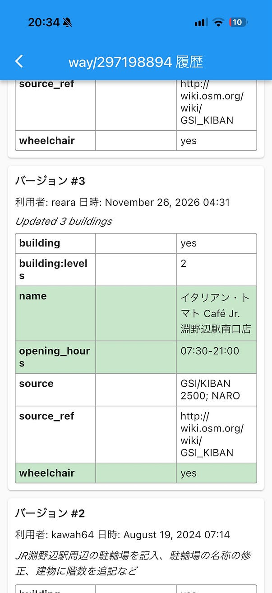
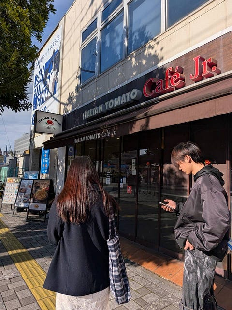
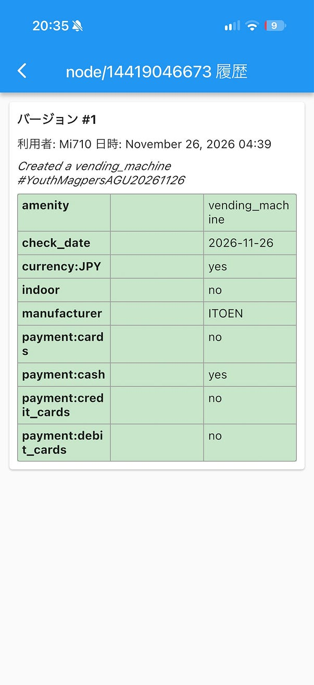
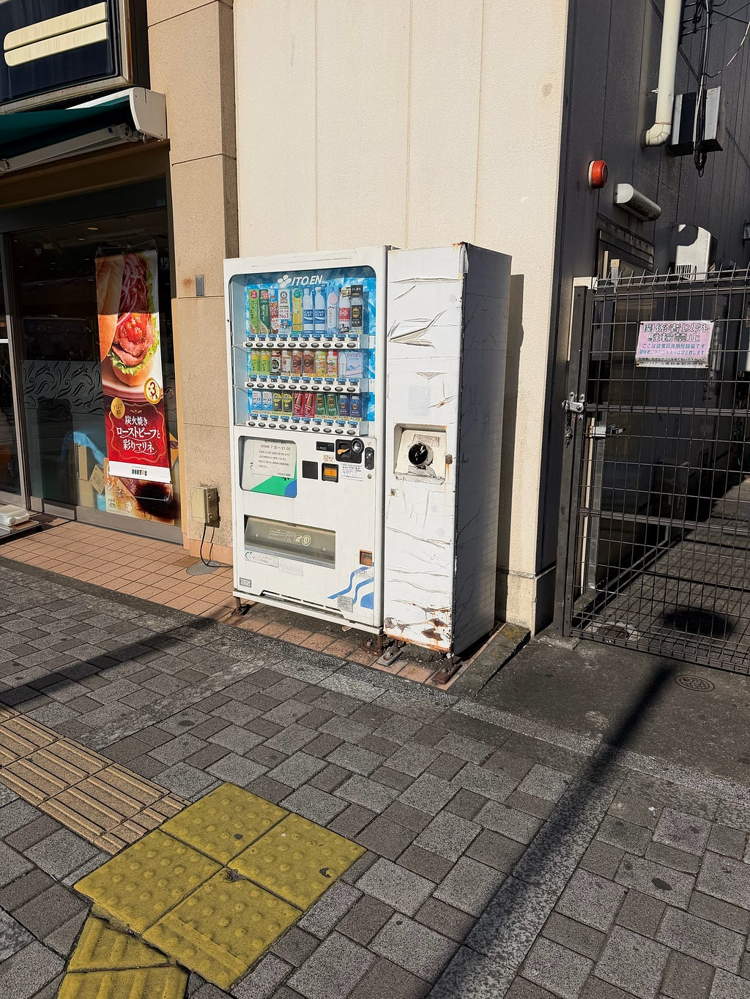
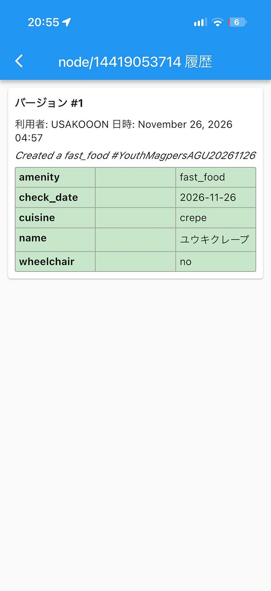
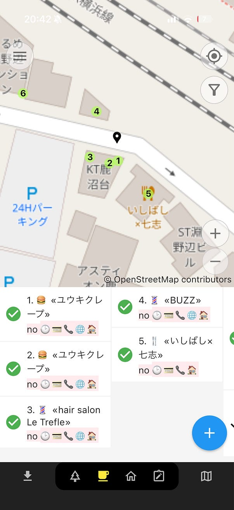
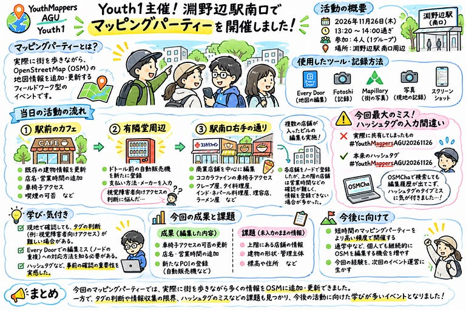

## Youth1週報(12/1)

## 淵野辺駅南口で開催したマッピングパーティー記録

3年の田邊です。

11月26日にYouthMappers AGUのYouth1が主催した、マッピングパーティーの成果報告です！

今回は、青山学院大学相模原キャンパスの最寄り駅である淵野辺駅の南口周辺を対象に、Every Doorを使ってOpenStreetMap（OSM）の編集を行いました。

当日の活動概要

当日は、僕を含めた4人でマッピングをしました。そのため、今回は4人1グループでマッピングパーティーを進めました。

Every Doorは全員インストール済みで、使い方もほとんど知っている状況でした。

13:20に淵野辺駅南口をスタートし、駅前のカフェの情報を編集した後、有隣堂周辺でマッピングを行いました。その後、南口から右手側の道沿いにある店舗や施設などをマッピングし、14時過ぎに解散しました。

今回は、FotoshiやMapillary、スクリーンショット、写真などで活動の記録を取りました。

また、編集履歴を後から確認できるよう、すべての編集に共通のハッシュタグを付けることにしました。

駅前のカフェをマッピング

まず、淵野辺駅南口にあるカフェの情報を編集しました。

建物自体はすでにOSMに登録されていたのですが、営業時間や店名、車椅子でのアクセス、喫煙の可否などの情報を新たに登録しました。

このように、建物がすでに登録されている場所でも、店舗に関する情報が不足している場合があります。

実際に現地で確認することで、既存の地図情報をより充実させることができました。

有隣堂周辺での編集作業

次に、有隣堂周辺でマッピングを行いました。

僕は、ドトールコーヒーショップの前にある自動販売機を、新たなPOI（Point of Interest）として登録しました。

その際に、自動販売機の支払い方法やメーカーについての情報も入力しました。

視覚障害者向けアクセスの判断に悩んだ

この自動販売機を編集する際、特に悩んだのが、視覚障害者向けアクセスについての情報です。

最初は、近くの道に点字ブロックがあるため、視覚障害者向けアクセスを「yes」と入力しようと考えました。

しかし、点字ブロックが自動販売機まで直接続いているわけではなく、音声案内なども確認できなかったため、「no」のようにも思えました。

だからといって、「limited」とするべきなのかも判断できなかったため、結局この項目については編集しませんでした。

今後は、TaginfoやOSM Wikiなどを使ってタグの定義や使い方を調べ、適切に判断できるようにしたいです。

今回のように、現地で情報を確認できても、どのタグを使って登録すればよいか分からない場合があることも学びました。

今回のマッピングパーティーでは、Every Doorでの編集だけでなく、Mapillaryや写真、スクリーンショットなどを使って、現地の状況も記録しました。

<https://www.mapillary.com/app/?pKey=2602616430224274>

（自動販売機のノードを追加した時の記録）

現地の情報を記録しておくことで、編集内容を後から振り返ったり、現地では判断できなかった情報を確認したりする際にも役立つと感じました。

淵野辺駅南口右手側のマッピング

続いて、淵野辺駅南口から右手側に伸びる道沿いでマッピングを行いました。

このエリアでは、ココカラファインの車椅子アクセスや、クレープ屋、タイ料理屋、インド・ネパール料理屋、理容店、ラーメン屋など、住宅ではなく商業店舗を中心に編集作業を行いました。

複数の店舗が入るビルの編集

ココカラファインはビルの1階にあり、その上の階にも医療系の店舗や施設がいくつか入っていました。

複数の店舗が1つのビルに入っている場合には、それぞれの店舗をノードとして登録し、階数や店名などの情報を入力することができます。

しかし、営業時間などの情報は、実際に上の階まで行かないと分からないことも多くあります。

今回のようなマッピングパーティーでは、道路から確認できる情報に限界があり、上階の店舗情報を十分に登録できない場合が多かったです。

また、クレープ屋の編集をした際には、誤って同じ店舗のノードを2つ作成してしまいました。

Every Door内で削除しようとしたところ、「存在しない」といった項目がありましたが、それを選択することで削除できるのか判断できず、今回は試しませんでした。

そのため、後からOSM上で編集し、重複したノードを削除して対応しました。

こうした編集ミスへの対処方法についても、今後さらに理解を深めたいです。

今回最大のミス！ハッシュタグの入力間違い

最後に、OSMChaを使って今回の編集履歴を確認しようとしました。

イベントの編集をまとめて確認できるよう、事前に参加者全員で共通のハッシュタグを設定していました。

本来設定する予定だったハッシュタグは、

#YouthMappersAGU20261126

です。

このハッシュタグは僕が入力し、コピーしてLINEで共有したものを、各自がEvery Doorに貼り付けるという方法で統一していました。

ところが、OSMChaで検索しても編集履歴が出てきません。

なぜだろうと思って確認すると、今回のイベント最大のミスに気が付きました。

なんと、僕が共有したハッシュタグは、

#YouthMagpersAGU20261126

だったのです！

「Mappers」のはずが、「Magpers」に……。

どうりでOSMChaの検索に引っかからなかったわけです。

全員で同じハッシュタグを使用できていたものの、そもそも共有した文字列が間違っていました。

今回は、事前にハッシュタグを確認することの重要性を学びました。

今後は、イベント開始前に文字列を確認し、実際に検索できるか試してから参加者へ共有するようにしたいです。

まとめ・今回の反省

今回のマッピングパーティーでは、全体的に車椅子でのアクセス可否や、店名、営業時間の追加・更新などを中心に編集作業を行いました。

しかし、上階にある店舗の情報や、建物の形状、管理主体、標高、住所など、多くの情報について未入力のまま終わってしまいました。

また、4人での活動は、1グループの人数としては適していたと感じましたが、複数のグループがあるか、高い頻度で活動しなければ、編集作業はなかなか進まないとも感じました。

一方で、今回のマッピングパーティーを通じて、Every Doorの使い方だけでなく、マッピングパーティーの進め方や開催方法についても学ぶことができました。

特に、実際に街を歩いてみると、OSMに登録されていない情報や、現地で確認しても判断が難しい情報が多くあることに気付きました。

また、ノードの重複やハッシュタグの入力ミスなど、実際に編集・運営してみなければ分からない課題も見つかりました。

今回の経験から、短時間のマッピングパーティーを頻繁に開催したり、個人でも通学中などに編集作業を行ったりするなど、OSMを編集できる機会を増やすことが、YouthMappers AGUとして取り組むべきことの一つだと思いました。

今後も今回の反省を生かしながら、マッピング活動を継続していきたいです！

グラレコです

⸻

関連リンク

* OpenStreetMap
* \* Every Door
* \* OSMCha
* \* Taginfo

今回の編集用ハッシュタグ： #YouthMagpersAGU20261126

活動日： 2026年11月26日

活動場所： 淵野辺駅南口周辺

---

[Youth1週報](https://medium.com/furuhashilab/youth1%E9%80%B1%E5%A0%B1-0b10be62ed31) was originally published in [Furuhashi(mapconcierge)Lab.](https://medium.com/furuhashilab) on Medium, where people are continuing the conversation by highlighting and responding to this story.
